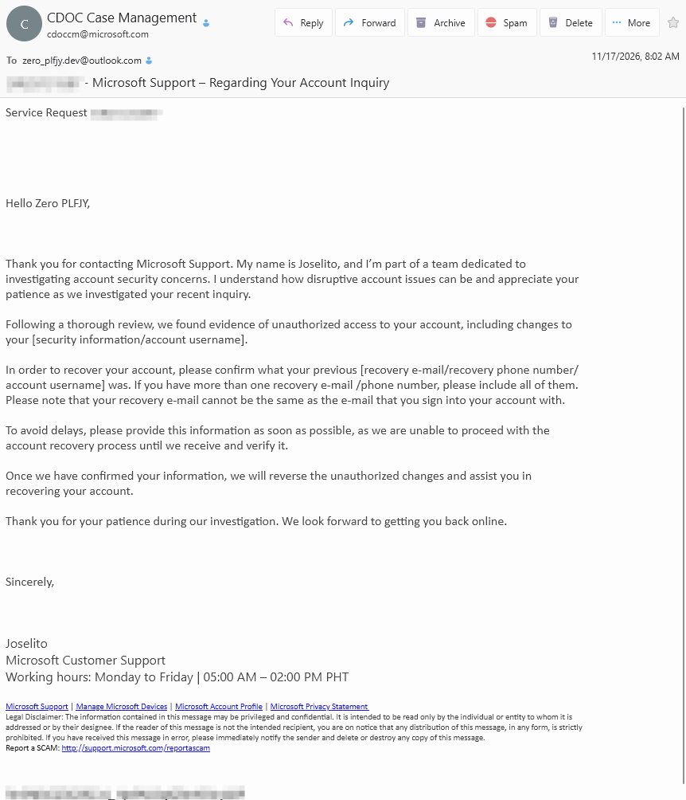
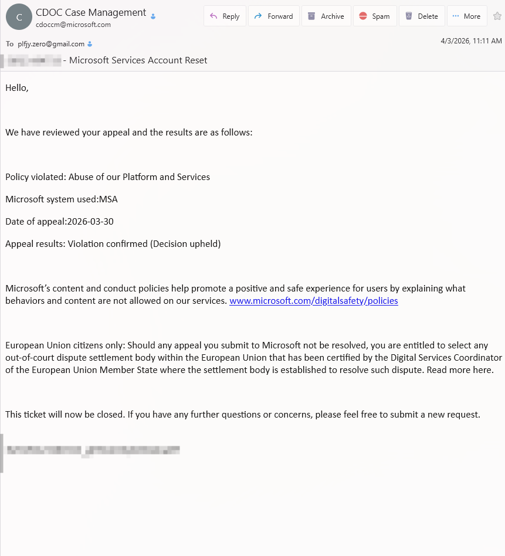
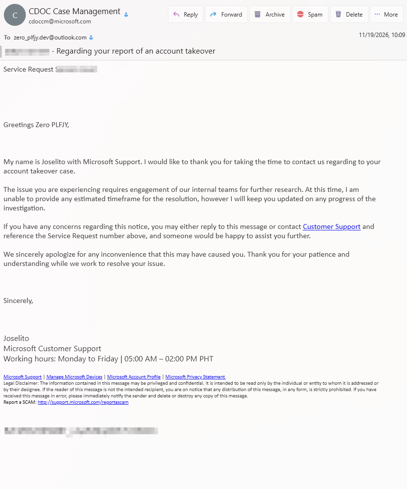
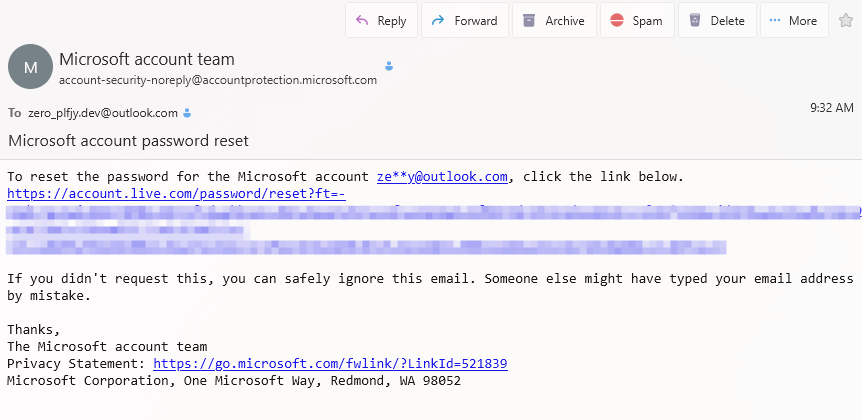
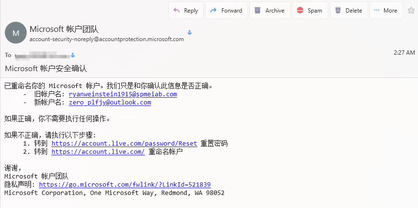

怀着激动的心情写下这些文字，我的微软账号，在今天，它终于的回到了我的手里；回望我这期间干过的每一件事情，我都十分的感慨，这一路真的太长了，长到我一度觉得看不到头，但结局总是好的，它至少回来了；

前序在 [记录一次微软账号被盗的经历](../ms-account-hacked)

先说说它是怎么回来的吧，首先是我前两个星期，又去尝试申请了一次解封，不过这一次，有所不同，我试图严格按照 *[[GUIDE] How to handle hacked account issues with Microsoft support](https://hypixel.net/threads/guide-how-to-handle-hacked-account-issues-with-microsoft-support.5429472/)* 这一篇文章的内容来写微软让我证明所有权的邮件，其中我加上了这一句话：

My account has been locked on Mar. 30, 2026 because it was compromised. Since then, I regained control of my account by reverting its security information to its original state. Now, I can change my password anytime using the original security email! Since I'm back in control of my account, could you please unlock it?

然后，收到了来自客服的回复：

这是第一次，在微软客服回复了我发送的所有权验证邮件，并且看来接待我的是个真人高级客服，此前全都是违反确认，不予解封：

这一次，我提供了我的相关信息，然后微软的客服跟我回复邮件，让我再提供一次，于是，我再次提供了他所让我提供的内容，接着他们告诉我，他们内部正在调查，让我耐心等待：

我本来都放着不想理他了，但是！就在今天的早上，我打开手机，收到了这一封邮件：

根据我看了这么多的微软账号相关的文章的经验，告诉我，这把稳了！我光速上去重置了账号，一切都看起来那么顺利，最终，账号回到了我手里，我欣喜若狂，当场直接喊出来了；

此外，我还看到我之前利用 30 天安全期限自动替换的密保邮箱收到了如下的消息：

也就是说，微软不仅给我的账号解封了，还自动把黑客的邮箱给我移出去了，也就是说，现在这个账号正式回归了我的掌控

这一次我不再大意，立刻上去添加了我所有能添加的密保，然后启用了无密码账号，以后，这个邮箱就不再用来做主力邮箱了，毕竟，我的 Minecraft 账号，那可是无形的资产；

---

写到这里，想着写个结尾的，但是吧……不想强行升华什么，嗯，就这样吧，感谢你能看到这里

2026.3.30 ~ 2026.11.21