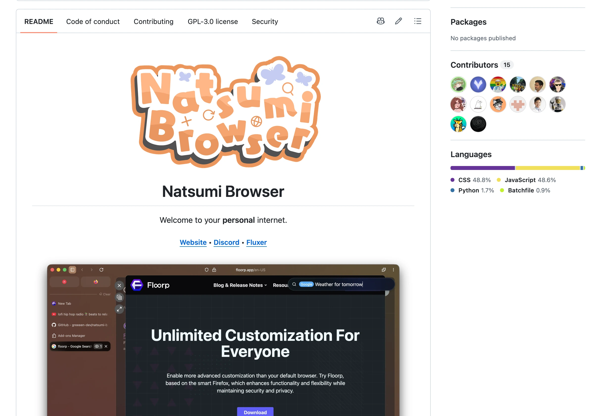
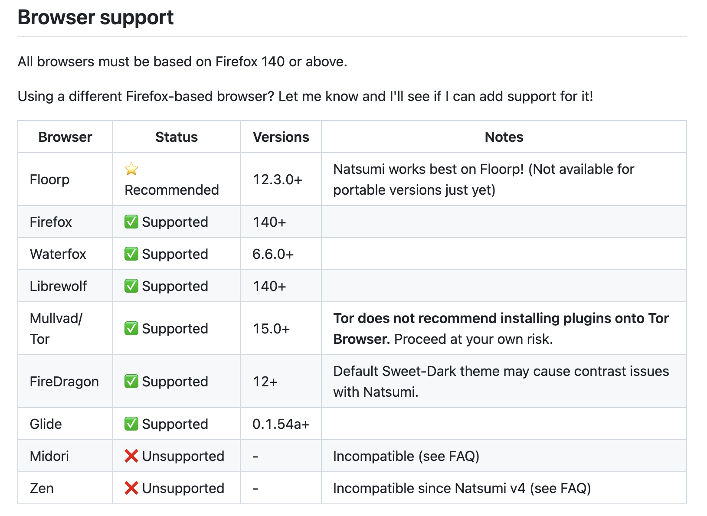
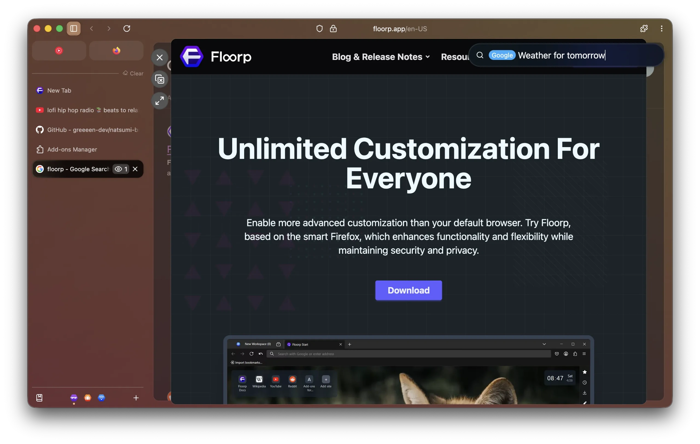
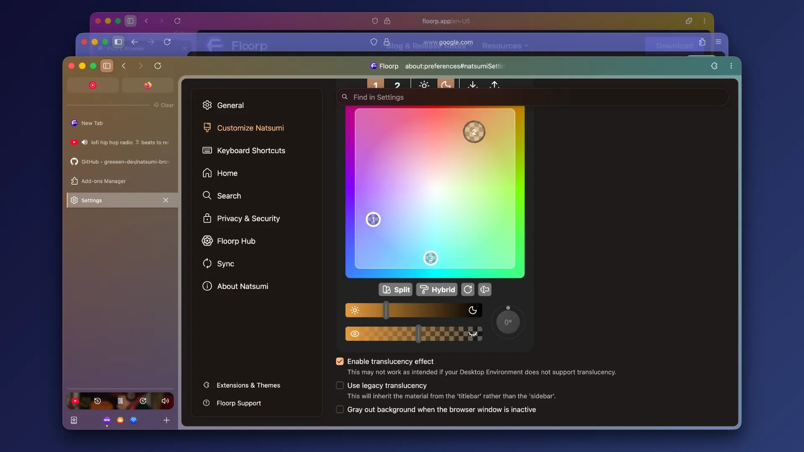
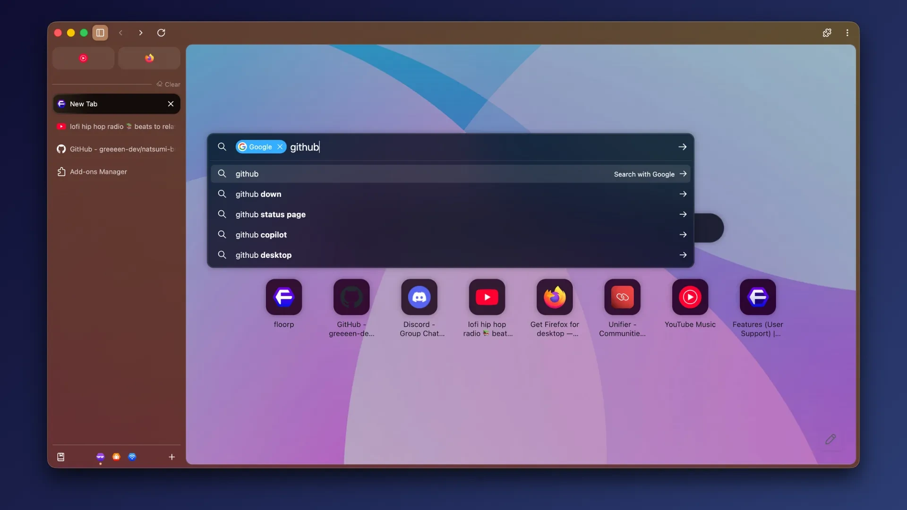
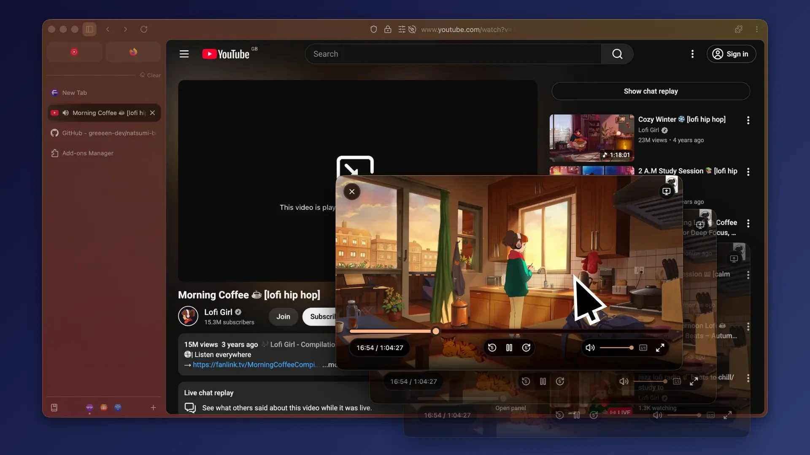
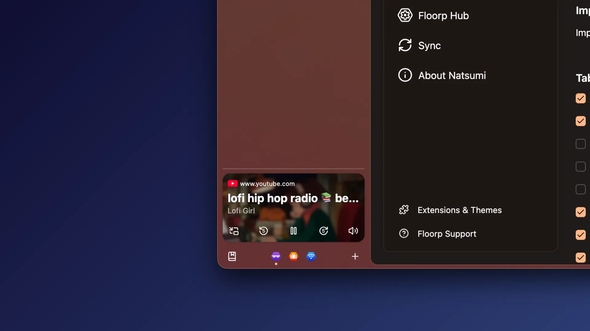

之前翻 GitHub 的时候发现了一个特别好的仓库，是一个 Firefox 的主题，叫做 Natsumi Browser，仓库 -> [greeeen-dev/natsumi-browser](https://github.com/greeeen-dev/natsumi-browser)



第一次看到真的被惊艳到了，我反正是非常的喜欢，然后就安装上了

原理上是利用 UserChrome 以及 fx-autoconfig 对 Gecko 内核的浏览器进行深度修改和定制，整体视觉效果还是十分的惊艳的



可以看到支持的浏览器还算是十分广泛的，至少说主流的 Firefox 内核浏览器都完成了支持

我这里就放一些图给各位看一下视觉效果吧，这些都是仓库里 Readme 的图片：











安装的话官方提供了安装器，还是十分简单的，这里我不是很想描述了

不过我想说的是我自己维护并制作的一个分支：

http://github.com/PLFJY/natsumi-browser

我主要做的改动是这样一些：

- 更及时的修复由于 Firefox 更新引入的样式问题
- Fluent 样式的页面切换动画
- 以及一个自己做的 Firefox 小动画，这个倒是可以放在这给你欣赏一下

<div style="max-width:960px;margin:auto;border:1px solid #8884;border-radius:8px;overflow:hidden;">
    
    <div style="display:flex;align-items:center;justify-content:center;padding:12px;border-top:1px solid #8884;">
        <button
            type="button"
            style="display:inline-flex;align-items:center;justify-content:center;gap:8px;padding:6px 16px;border:1px solid #8885;border-radius:6px;background:transparent;color:inherit;cursor:pointer;font:inherit;"
            onclick="document.getElementById('firefox-kit-animation').src='https://raw.githubusercontent.com/PLFJY/natsumi-browser/main/natsumi/icons/firefox-kit-startup.svg?t='+Date.now();"
        >
            <svg width="16" height="16" viewBox="0 0 24 24" fill="none" stroke="currentColor" stroke-width="2" stroke-linecap="round" stroke-linejoin="round">
                <path d="M3 12a9 9 0 1 1 2.6 6.4M3 5v7h7"/>
            </svg>
            重新播放
        </button>
    </div>
</div>

特别萌有没有！用 GPT 6 Astra 大人做的

这个是一个我额外的启动动画

然后至于安装方面，那先用官方的安装器安装好，因为官方的会自动帮忙配置好 fx-autoconfig，我们直接进入 profile 的 chrome 文件夹，然后在这里唤起终端，输入下面的 git 命令：

```
git init
git remote add origin https://github.com/PLFJY/natsumi-browser.git
git fetch origin
git reset --hard origin/main
git branch -M main
git branch --set-upstream-to=origin/main main
```

十分的方便啊，每次更新就只需要：

```
git fetch origin
git reset --hard origin/main
```

赶紧的，去品鉴一下吧！本次的分享就到这里，感谢你能读到这里